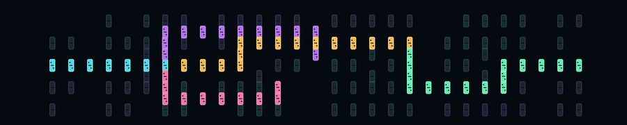

### Hi there 👋

  

## I'm Devichand.
These days I’m more interested in understanding evolution and intelligence. I’m curious about understanding how intelligence and learning emerges from a collection of humans, cells, neurons in a neural network and what role each unit plays in the overall collection and which fundamental rules guide the evolution of a collection of interacting units.

My long-term goal is to develop models whose architectures, objectives, and representations emerge through evolution rather than being imposed by human assumptions. Such a model would develop its own organization of interacting units, learning how to represent its environment, act within it, and form and revise its objectives. It would continue to evolve as its environment changes, guided by the fundamental principles through which interacting systems organize, adapt, and evolve.

Feel free to reach out to me if you have questions or discuss anything related to my research or blogs, or are interested in collaborating.

##  Connect with Me

<!--

